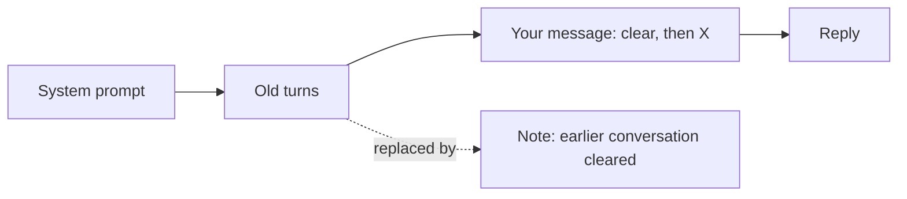

# dsh-clear-conversation

**Say "clear everything above" and DeepSeek Harness actually forgets it.**

[](https://github.com/deepseek-ai/deepseek-harness)
[](https://github.com/topics/dsh-plugin)
[](LICENSE)


Long sessions get slow and expensive: every request resends the whole history, and old topics leak into new answers.
This [DeepSeek Harness](https://github.com/deepseek-ai/deepseek-harness) (`dsh`) plugin lets you drop that history in plain words, mid-conversation, without starting a new session.

What a session looks like (illustrative):

```text
You:   My favourite colour is green. Now help me name a cat.
dsh:   How about "Basil"? It suits a green-loving owner.

You:   Clear everything above, then tell me a joke.
dsh:   [clear_conversation]  Context cleared.
       Why don't skeletons fight? They don't have the guts.

You:   What's my favourite colour?
dsh:   I don't know. You haven't told me in this conversation.
```

## Quick start

```sh
dsh plugin --profile web add github:William20100221/dsh-clear-conversation
dsh web
```

That's it: no build step and no configuration. Using the DeepSeek Harness desktop app? Open **Plugins → Add plugin** and enter `github:William20100221/dsh-clear-conversation`. New to dsh, or want to try it safely first? See [TESTING.md](TESTING.md).

## Features

- **Ask naturally.** "Clear everything above", "forget the previous chat", "start over", 清空上下文, in any language.
- **Keeps your request.** "Clear, then do X" still does X: only the turns before your message are dropped.
- **Saves tokens immediately.** The model stops receiving the old turns from its very next request, even within the same turn.
- **Nothing is deleted.** Old turns stay in the transcript and the session log; they just stop being sent.
- **Hard to trigger by accident.** Casual phrases like "forget it, let's move on" or "how do I clear the context?" are ignored.
- **`/clear` command.** Clear everything yourself while the agent is idle (Web, Desktop and SDK).
- **See what you saved.** `/clear` shows a collapsible "Context cleared" card with the input tokens released, measured by dsh's own token meter. Open it to see which prompts were cleared.
- **Update reminders.** When a newer release exists, the next clear tells you, with how to update. Set `DSH_CLEAR_CONVERSATION_NO_UPDATE_CHECK=1` to switch the check off.
- **Safe by construction.** The system prompt is never touched, and a clear that would split an unfinished tool call is refused.

## How it works

dsh builds every request from the session's *surface*, an ordered list of messages. Its own `/compact` command replaces a run of old turns with an AI-written summary. This plugin uses the same mechanism, but writes one short note instead of a summary, so it costs nothing to run.



## FAQ

**Does it delete my messages?** No. The transcript and session log keep everything. Only the model's view changes.

**Can I undo a clear?** Not yet. The old turns stay readable, but cannot be put back into the model's context.

**Can the cleared messages be folded away in the transcript?** Not from a plugin today. dsh's Web UI gives plugins no way to hide messages it has already drawn, which is also why messages compacted by `/compact` stay visible. The "Context cleared" card shows where the clear happened instead.

**Does it contact the internet?** Once per start, to ask GitHub for the latest release number. Nothing about your sessions is sent. Set `DSH_CLEAR_CONVERSATION_NO_UPDATE_CHECK=1` to switch it off.

**Which dsh surfaces does it work in?** The tool works everywhere the model runs. `/clear` appears where dsh shows commands: Web and SDK, not ACP or headless.

**How do I remove it?** `dsh plugin --profile web remove dsh-clear-conversation`, then restart dsh.

**Status?** Preview, for dsh 0.2.1-rc.5 and later 0.2.x releases. Clearing by request and `/clear` are confirmed in the desktop app; the `/clear` card and token count are new and covered by tests. Please [open an issue](https://github.com/William20100221/dsh-clear-conversation/issues) if something breaks.

## Using Cherry Studio?

The Cherry Studio version lives in its own repository: [cherry-studio-clear-conversation](https://github.com/William20100221/cherry-studio-clear-conversation). It has an MCP server for chats and a skill for agents.

## Development

```sh
npm test
```

The tests exercise the clearing logic against a stand-in session; they do not start dsh.

## License

MIT.
